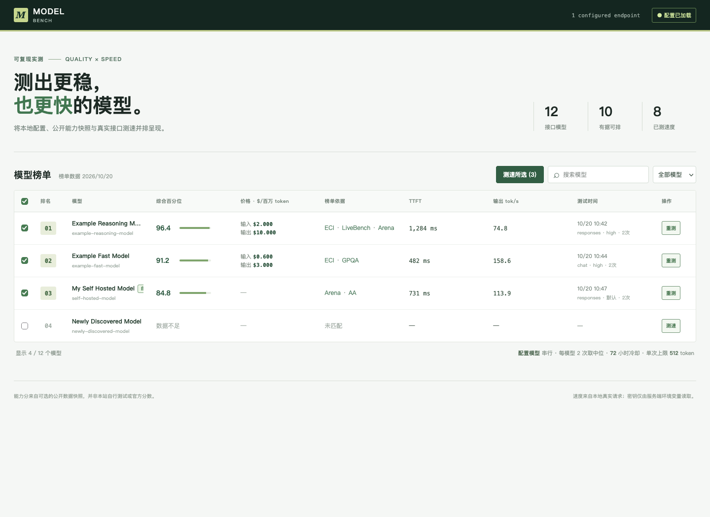

# Model Bench

一个面向任意 LLM API 的本地测速工具：以**严格串行**的真实流式请求记录 TTFT、可见输出 tok/s、token 用量、协议和思考强度，并提供一个默认只读的本地看板。

仓库只包含代码、配置模板和虚构示例；不包含可用端点、API Key、模型清单或测速结果。



*示例图使用虚构模型和测速数据。*

## 特性

- OpenAI Responses、Chat Completions 和 Anthropic Messages 原生协议。
- 每模型多样本串行请求并取中位数；不会并发抢占模型服务。
- `id`、`display_name` 与 `request_model` 分离，适合自建服务的模型别名。
- 所有密钥仅从环境变量读取；配置文件不保存密钥。
- Web 默认只读。浏览器测速必须显式开启，并可要求管理员令牌。
- SQLite 保存最新结果，可导出 JSON 或 CSV。
- 排名与价格等展示字段可由本地 JSON 提供，不会影响测速引擎。

## 安装

```bash
git clone <your-fork-url> model-bench
cd model-bench
UV_DEFAULT_INDEX=https://pypi.tuna.tsinghua.edu.cn/simple uv sync --extra test
uv run model-bench init
```

`model-bench init` 会生成 `model-bench.toml`。它和 `.env` 已被 `.gitignore` 忽略。

在 `.env` 填入示例配置引用的环境变量：

```bash
MODEL_BENCH_GATEWAY_KEY=your-secret-key
```

模型、端点和协议全部由 `model-bench.toml` 管理。不要把本地端点配置提交到 Git。

## 常用命令

```bash
# 配置校验，不发送任何请求
uv run model-bench validate

# 查看某个端点实际暴露的模型，不会写入配置或自动测速
uv run model-bench discover --endpoint primary-gateway

# 默认选择配置规定的范围，严格串行测速
uv run model-bench benchmark

# 明确选择模型、标签或全量；--force 忽略冷却期
uv run model-bench benchmark --model example-reasoning-model --force
uv run model-bench benchmark --tag coding --force
uv run model-bench benchmark --all --force

# 导出本地 SQLite 的最新结果
uv run model-bench export --format csv --output results.csv

# 启动只读本地看板
uv run model-bench serve --host 127.0.0.1 --port 8765
```

## 配置模型

下面的核心设置体现了显示名与服务端真实模型名的分离：

```toml
[[endpoints]]
id = "self-hosted"
base_url = "http://127.0.0.1:8000/v1"
protocol = "chat"
kind = "self-hosted"

[[models]]
id = "My-Self-Hosted-Model-2026-10"
endpoint = "self-hosted"
request_model = "actual-server-model-id"
display_name = "My Self Hosted Model"
protocol = "chat"
tags = ["text", "self-hosted"]
```

`reasoning_effort` 可设为 `low`、`medium`、`high` 或 `max`。该值会被送到适配协议支持的参数中。每个模型只配置一个你实际使用的档位，避免把同一模型的不同思考档位混在同一测速列表。

## Web 安全

开源部署应保持以下默认值：

```toml
[web]
allow_benchmark = false
```

这样网页没有测速按钮，访问者不能触发付费请求。仅在受控部署中需要网页测速时，才设置 `allow_benchmark = true`，并配置 `admin_token_env`；请求需带 `X-Model-Bench-Token`。对外展示时，建议只展示静态结果，通过 CLI 或受控定时任务测速。

需要在网页中维护订阅地址与模型映射、刷新端点的 `/models`，以及逐个或批量测速时，可在受控环境开启：

```toml
[web]
allow_benchmark = true
allow_config_ui = true
admin_token_env = "MODEL_BENCH_ADMIN_TOKEN"
```

此时 `/settings` 可直接添加订阅端点、刷新 `/models`、勾选导入模型，也可以编辑和校验完整 `model-bench.toml`；保存后立即重载。主榜单可单个测速或勾选多个模型批量测速。批量任务仍严格串行，单个失败不会阻止后续模型继续执行。它不会读取或展示 `.env` 的任何值；API Key 仍只能通过环境变量配置。对外部署时，请同时使用 HTTPS、部署层认证和管理员令牌。

## 可选排名与价格

`[paths]` 可引用本地 `rankings` 和 `prices` JSON 文件。两者都不是测速所必需的：

- `rankings` 是用户允许使用和重新分发的数据快照。无法唯一匹配的模型不会参与排序。
- `prices` 是用户维护的价格快照；自建模型可写为 `null`。
- 仓库只带最小示例。使用外部数据前，请自行核实上游条款、访问方式和数据许可。

## 开发

```bash
UV_DEFAULT_INDEX=https://pypi.tuna.tsinghua.edu.cn/simple uv sync --extra test
uv run pytest
uv run model-bench --config examples/model-bench.example.toml validate
```

发布前请执行：

```bash
git status --ignored
git check-ignore model-bench.toml .env data/results.sqlite3
```

确认任何 Key、端点配置、SQLite 结果和本地模型清单均未被追踪。

## License

Apache-2.0。见 [LICENSE](LICENSE)。安全问题请按 [SECURITY.md](SECURITY.md) 提交，不要在 issue 中附带 API Key 或可用端点。
